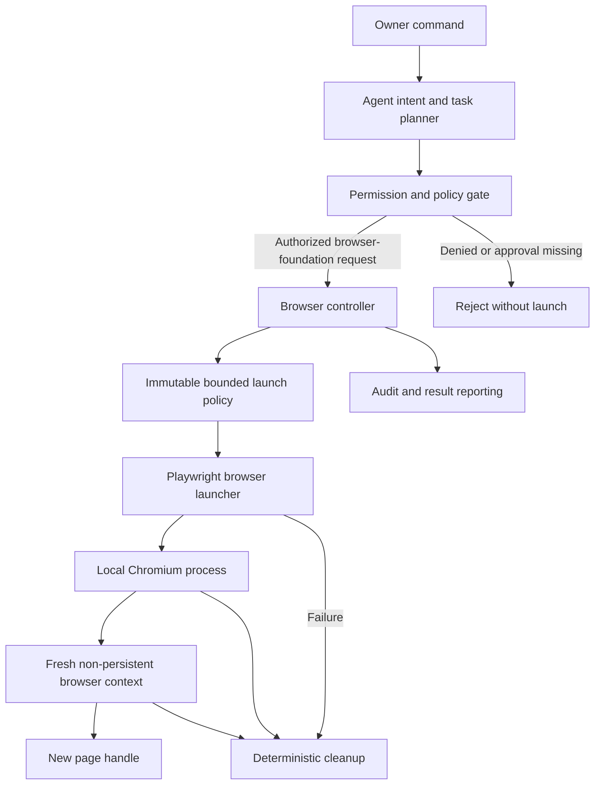

# APAA-S09-C01-P01 — Browser Automation Architecture

**Roadmap mapping:** Subject S09 Browser Automation → Chapter C01 Browser Foundation → Part P01 Browser Automation Architecture  
**Repository:** `glad4u7-crypto/TLP-Write-Test`  
**Branch:** `feature/apaa-s09-c01-p01-browser-launch`  
**Status:** Architecture specification added; implementation evidence and exact-head CI are tracked separately below.

## 1. Purpose and boundary

P01 defines how APAA owns and safely creates an isolated browser session. It is an architecture and launch-foundation part, not permission to browse arbitrary websites or perform website actions.

The architecture must preserve these rules:

- Browser launch is explicit, bounded, and fail-closed.
- Each launch creates a fresh, non-persistent browser context; no user profile or imported cookies.
- Downloads are disabled; arbitrary executable paths and arbitrary launch arguments are not exposed.
- A launch failure cleans up resources already created.
- P01 does not click, fill, submit, log in, download, upload, or visit a user-selected site.
- Browser/Worker dispatch remains disabled until the separate host, network, authorization, and Owner-acceptance gates pass.
- Ask First remains the default for sensitive actions. No payment, purchase, checkout, financial transaction, paid provider, Auto-Run, or unapproved merge.

## 2. Logical architecture

The diagram is a logical responsibility map. It does not claim that every box is currently wired into the production UI or that the host OS is sandboxed.

## 3. Component responsibilities

| Component | Responsibility | Current repository boundary |
|---|---|---|
| Agent/task layer | Understands the requested task and proposes a browser-foundation operation | Does not itself launch Chromium |
| Permission/policy gate | Rejects unauthorized sensitive actions; preserves explicit Owner approval | Browser launch must not become a route around action authorization |
| `BrowserLaunchPolicy` | Immutable, allowlisted launch options and bounded timeout | `core/browser_launch.py` |
| `PlaywrightBrowserLauncher` | Starts local Chromium and creates a fresh context | `core/browser_launch.py`; Playwright remains optional |
| `BrowserSession` | Owns page, context, browser and Playwright manager lifecycle | `core/browser_launch.py` |
| Runtime support | Checks whether the optional browser runtime is available | `core/runtime_support.py` |
| Tests | Verify policy bounds, isolation defaults, cleanup and fail-closed errors | `tests/test_browser_launch.py` and related security tests |

Other browser execution, URL policy, proxy, OCI and attestation modules on the existing feature branch are separate security/integration work. Their presence must not be interpreted as proof that a production sandbox is available.

## 4. Launch lifecycle

1. Receive a bounded browser-foundation request through the authorized application path.
2. Validate the immutable launch policy, including the 1,000–60,000 ms launch-timeout bound.
3. Confirm the optional Playwright runtime is available; do not install packages or download browser binaries automatically.
4. Start the Playwright manager and local Chromium in headless mode by default.
5. Create a fresh browser context with downloads disabled and service workers blocked.
6. Create one page and return an owned `BrowserSession`.
7. On close or any partial launch failure, attempt cleanup of context, browser, and manager; do not fall back to a persistent profile or an alternate/direct launch path.

P01 deliberately stops at the page handle. URL navigation belongs to the separately specified navigation work; page inspection belongs to the element-inspection work.

## 5. Failure and resource ownership

- The launcher owns every resource it creates.
- Cleanup is idempotent at the session boundary.
- A failed context/page creation must close any browser and manager already started.
- A closed session must not expose its page handle.
- Cleanup errors are reported; cleanup continues for remaining owned resources.
- No retry may silently weaken the policy or reuse a persistent browser profile.

## 6. Trust and security boundaries

**What P01 provides:** a bounded controller-level launch API, fresh browser context, disabled downloads, explicit resource ownership, and deterministic best-effort cleanup.

**What P01 does not provide:** OS/container isolation, filesystem confinement, network-egress denial, DNS-rebinding protection, Android/Termux compatibility, login/session handling, live website authorization, or production readiness. These require their own implementation and qualification evidence.

Desktop/Linux CI is not physical Android acceptance. Until an actual Android/Termux qualification is performed, Android browser launch remains unsupported/fail-closed. Until real-host sandbox and egress controls are independently qualified, live Browser/Worker dispatch remains disabled.

## 7. P01 acceptance checklist

- [x] Architecture responsibilities and trust boundaries documented.
- [x] Existing bounded immutable launch policy is implemented.
- [x] Fresh non-persistent context and downloads-disabled defaults are implemented.
- [x] Resource ownership and failure cleanup are implemented.
- [x] Focused launch lifecycle tests exist.
- [ ] Exact current branch-head CI must be visible and successful before this documentation update is marked CI-verified.
- [ ] Physical Android qualification remains an external platform gate; it is not inferred from CI.
- [ ] Production sandbox/egress qualification remains outside P01 and is not claimed here.

## 8. Verification record

The existing P01 scope record reports a successful exact-head APAA Security CI run for commit `3a3f03a7fc22e63fa3c2b070151852b80671f2da`. However, the branch currently points to a later documentation commit, `019e1bbd96daef813601a689341a0a24cc12bc57`, and the exact-head workflow/status lookup for that later head returned no records. Therefore the historical P01 pass is evidence for its recorded commit only; it is not represented as a pass for a later head. This architecture document must receive its own exact-head CI result before the branch update is called CI-verified.

**Safety posture:** Draft PR only; no merge, deployment, live website access, Auto-Run, payment, purchase, or production activation.
